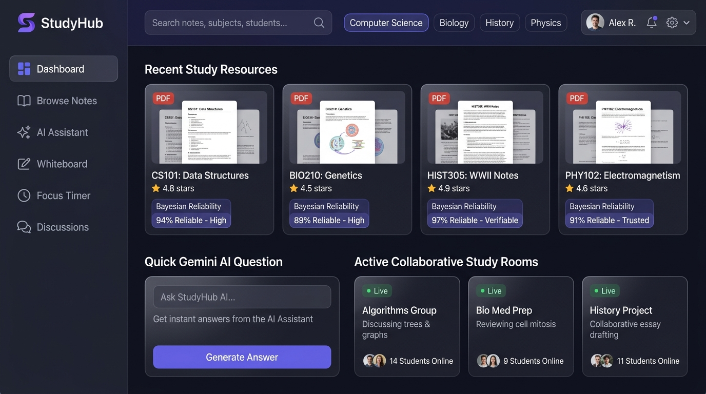

<div align="center">

# 🎓 StudyHub
### Collaborative Academic Resource Platform with AI Study Assistance

[](https://spring.io/projects/spring-boot)
[](https://www.oracle.com/java/)
[](https://react.dev/)
[](https://www.typescriptlang.org/)
[](https://www.mysql.com/)
[](https://ai.google.dev/)
[](https://www.docker.com/)
[](LICENSE)

<br/>

**An enterprise-grade full-stack web application designed for university departments to share verified academic resources, resolve student doubts with AI, and collaborate in real-time study sessions.**

[Core Features](#-core-features) • [System Architecture](#-system-architecture) • [Security & Integrity](#-security-and-data-integrity) • [Installation & Setup](#-installation--setup) • [Testing & Quality Assurance](#-testing--quality-assurance) • [API Directory](#-api-endpoints-overview) • [Cloud Deployment](#-cloud-deployment)

</div>

---

## 📸 Application Preview

<div align="center">
  
  <p><em>StudyHub Dashboard: Verified Course Notes, Bayesian Trust Ratings, Gemini AI Academic Assistant, and Live Collaborative Study Rooms</em></p>
</div>

---

## 📌 Project Overview

In university academic environments, lecture materials, past examination questions, and study notes are frequently fragmented across informal chat channels, personal cloud drives, and unmoderated forums. This creates significant friction in discovering high-quality materials, while duplicate and unverified files degrade academic efficiency.

**StudyHub** centralizes departmental academic resources through peer verification and smart automation:
1. **Curated & Peer-Rated Notes**: Every document features a Bayesian-weighted reliability score calculated from authenticated peer reviews, with server-enforced safeguards preventing self-review inflation.
2. **AI-Powered Academic Assistance**: Integrated Google Gemini 1.5 Flash provides on-demand document summarization, key concept extractions, and 24/7 contextual doubt resolution.
3. **Real-Time Collaboration**: Interactive STOMP WebSocket whiteboards and synchronized Pomodoro study sessions keep study cohorts engaged and focused.

---

## ✨ Core Features

<table>
<tr>
<td width="50%" valign="top">

### 📚 Peer-Reviewed Resource Repository
- **Multi-Format Support**: Upload and stream PDF notes, video lectures, and syllabus references.
- **Magic-Byte File Verification**: Server-side inspection of binary `%PDF-` file headers to validate genuine documents and prevent MIME spoofing.
- **Bayesian Reliability Scoring**: Mathematical weighted averaging ensures score stability and eliminates bias from sparse reviews.
- **Integrity Constraints**: Automatically blocks resource authors from reviewing or rating their own submissions.
- **Structured Taxonomy**: Filter resources hierarchically by Department, Semester, Subject, and custom academic tags.

</td>
<td width="50%" valign="top">

### 🤖 Gemini AI Study Assistant
- **Automated Summarization**: Extracts executive summaries and key bullet takeaways from uploaded lecture documents.
- **Document Metadata Analysis**: Identifies core topics and suggests relevant academic tags.
- **Contextual Doubt Resolution**: Answers engineering and science questions with clear step-by-step reasoning.
- **Autonomous Fallback Engine**: Smoothly switches to an internal structured educational knowledge base when operating offline or without cloud API credentials.

</td>
</tr>
<tr>
<td width="50%" valign="top">

### 🎨 Live Collaborative Whiteboard
- **Multi-User Canvas**: Low-latency broadcasting of pen strokes, geometric shapes, and text annotations over STOMP WebSockets (`/ws-studyhub`).
- **Canvas Snapshots**: Room hosts can save high-fidelity canvas states to MySQL and restore them across sessions.
- **Room Sharing**: 6-character secure room codes for instant student coordination.

</td>
<td width="50%" valign="top">

### ⏱️ Focus Sessions & Doubt Forum
- **Pomodoro Timer**: Tracks focused study minutes categorized by subject.
- **Department Leaderboard**: Weekly peer study rankings based on verified focus intervals.
- **Peer Q&A Forum**: Community-driven doubt forum with upvoting and author-accepted answers.
- **Push Notifications**: Live STOMP alerts for new replies, accepted answers, and peer reviews.

</td>
</tr>
</table>

---

## 🏗️ System Architecture

StudyHub is structured as a decoupled, multi-tier enterprise application:

```
┌────────────────────────────────────────────────────────────────────────┐
│                       React 18 Single-Page App                         │
│            TypeScript 5.6 │ Tailwind CSS │ Axios │ STOMP Client        │
└───────────────────────────────────┬────────────────────────────────────┘
                                    │ HTTP REST / WebSocket (WSS)
                                    ▼
┌────────────────────────────────────────────────────────────────────────┐
│                   Spring Security 6 Filter Chain                       │
│    Bucket4j RateLimitingFilter ──► JwtAuthenticationFilter ──► RBAC    │
└───────────────────┬─────────────────┬─────────────────┬────────────────┘
                    │                 │                 │
                    ▼                 ▼                 ▼
             ┌─────────────┐   ┌─────────────┐   ┌─────────────┐
             │  Resource   │   │ Gemini AI   │   │ Collaborative│
             │  & Search   │   │ Subsystem   │   │ Whiteboard  │
             └──────┬──────┘   └──────┬──────┘   └──────┬──────┘
                    │                 │                 │
                    └────────────┬────┴─────────────────┘
                                 │
                                 ▼
┌────────────────────────────────────────────────────────────────────────┐
│                 Spring Data JPA / Hibernate ORM Layer                  │
└────────────────────────────────┬───────────────────────────────────────┘
                                 │
                                 ▼
┌────────────────────────────────────────────────────────────────────────┐
│                   MySQL 8.0 Relational Persistence                     │
└────────────────────────────────────────────────────────────────────────┘
```

### Bayesian Reliability Rating Formula

To maintain fair ratings on newly uploaded documents and eliminate score distortion, StudyHub implements Bayesian weighted averaging:

$$R = \frac{v \cdot \bar{r} + m \cdot C}{v + m}$$

Where:
- $v$: Total review count for the resource.
- $\bar{r}$: Average star rating of peer reviews ($1.0 - 5.0$).
- $m$: Confidence threshold weighting parameter ($m = 5$).
- $C$: Prior baseline rating ($C = 3.5$).

This ensures that resources with very few reviews do not display misleading 100% reliability; scores stabilize progressively as more peer reviews are submitted.

---

## 🔒 Security and Data Integrity

StudyHub adheres to modern application security best practices:

1. **Dual-Token JWT Authentication**:
   - Short-lived Access Tokens (15 minutes) for API authorization.
   - Long-lived Refresh Tokens (7 days) stored securely in MySQL with SHA-256 cryptographic hashing.
2. **Refresh Token Rotation (RTR) & Breach Detection**:
   - New token pairs are generated upon each refresh, immediately revoking the predecessor.
   - If a revoked token is reused, the security system detects a potential replay attack and revokes all active sessions for that account.
3. **Bucket4j Rate Limiting**:
   - In-memory token bucket algorithm enforces a 20 request/minute ceiling on authentication and AI endpoints to protect against brute-force and resource exhaustion attacks.
4. **Hardened File Storage**:
   - Uploaded files undergo MIME type checking and binary magic-byte inspection (`%PDF-`).
   - Stored with non-enumerable UUID identifiers outside the public web root to prevent direct execution and path-traversal vulnerabilities.

---

## 👥 Role-Based Access Control (RBAC)

StudyHub provides strict role segregation tailored for educational institutions:

| Role | Scope & Permissions | Target Audience |
|:---|:---|:---|
| **Student** | Upload academic notes, browse verified resources, post & answer doubt questions, join live collaborative whiteboard study rooms, participate in Pomodoro focus sessions | Undergraduate & Postgraduate Students |
| **Faculty** | Review & endorse academic resources, provide verified instructor answers, curate syllabus topic taxonomies | Professors, Lecturers & Teaching Assistants |
| **Admin** | Access system analytics, resource moderation queue, user account management, and institutional settings | Department Administrators & IT Staff |

---

## 🚀 Installation & Setup

### Option 1: Docker Compose (Recommended)

Launches the entire containerized application stack (MySQL 8 + Spring Boot 3 + React/Nginx):

```bash
# 1. Clone the repository
git clone https://github.com/VenuMadhavi-77/studyhub.git
cd studyhub

# 2. Configure environment
cp .env.example .env

# 3. Build and run containers
docker compose up --build -d
```

| Service | Address | Description |
|:---|:---|:---|
| **Frontend Web App** | `http://localhost` | React SPA served via Nginx (Port 80) |
| **Backend REST API** | `http://localhost:8080/api/v1` | Spring Boot API server |
| **Swagger OpenAPI UI** | `http://localhost:8080/swagger-ui.html` | Interactive API documentation |
| **Actuator Health** | `http://localhost:8080/actuator/health` | Health & metrics probe |

---

### Option 2: Local Development Setup

#### Prerequisites
- **Java JDK 21+** (`java -version`)
- **Apache Maven 3.9+** (`mvn -v`)
- **Node.js 20+ & npm** (`node -v`)
- **MySQL 8.0** running on port `3306`

#### 1. Database Initialization
```sql
CREATE DATABASE IF NOT EXISTS studyhub_db CHARACTER SET utf8mb4 COLLATE utf8mb4_unicode_ci;
```

#### 2. Backend Startup (Spring Boot)
```bash
cd backend
mvn clean install
mvn spring-boot:run
```
> Backend runs at: `http://localhost:8080`

#### 3. Frontend Startup (React + Vite)
```bash
cd frontend
npm install
npm run dev
```
> Frontend runs at: `http://localhost:3000`

---

## 🧪 Testing & Quality Assurance

StudyHub is thoroughly verified through automated tests across both backend and frontend layers:

### Backend Testing (JUnit 5 & Spring Boot Test)
```bash
cd backend
mvn test
```
- **Service Layer Tests**: Verification of authentication logic, JWT token issuance, Bayesian reliability scoring, and recommendation algorithms.
- **Security & Web Layer Tests**: Validation of MockMvc endpoints, CORS preflight handling, role-based authorization filters, and rate limiting.

### Frontend Validation (TypeScript & Vite)
```bash
cd frontend
npm run build
```
- **Static Type Checking**: Strict compile-time TypeScript validation across all modules, API models, and components.
- **Production Asset Bundling**: Code splitting and tree-shaking via Vite and Rollup.

---

## 📡 API Endpoints Overview

| Method | Endpoint | Access Level | Description |
|:---|:---|:---|:---|
| `POST` | `/api/v1/auth/register` | Public | Register new student or faculty account |
| `POST` | `/api/v1/auth/login` | Public | Authenticate credentials and receive JWT tokens |
| `POST` | `/api/v1/auth/refresh` | Public | Atomic refresh token rotation |
| `GET` | `/api/v1/users/me` | Authenticated | Retrieve authenticated user profile |
| `GET` | `/api/v1/taxonomy/departments` | Public | List all engineering departments |
| `GET` | `/api/v1/search/resources` | Public | Search resources by keyword, department, or tags |
| `POST` | `/api/v1/resources` | Authenticated | Multipart upload with file and JSON metadata |
| `GET` | `/api/v1/resources/{id}/download` | Authenticated | Stream and download file content |
| `POST` | `/api/v1/resources/{id}/reviews` | Authenticated | Submit peer review (Self-reviews rejected) |
| `POST` | `/api/v1/doubts` | Authenticated | Post an academic doubt question |
| `POST` | `/api/v1/doubts/{id}/answers` | Authenticated | Submit answer to an existing doubt question |
| `POST` | `/api/v1/whiteboard/sessions` | Authenticated | Create a collaborative whiteboard session |
| `POST` | `/api/v1/focus/sessions/start` | Student | Begin Pomodoro focus interval |
| `GET` | `/api/v1/focus/leaderboard` | Authenticated | View department weekly focus leaderboard |
| `POST` | `/api/v1/ai/doubt-assistant` | Authenticated | Ask AI assistant for step-by-step explanation |
| `POST` | `/api/v1/ai/summarize/{id}` | Authenticated | Generate AI executive summary & revision notes |
| `GET` | `/api/v1/admin/stats` | Admin Only | Platform statistics and analytics |
| `PATCH`| `/api/v1/admin/resources/{id}/moderation`| Admin Only | Approve or reject uploaded resource |

Full interactive API documentation is available via **Swagger UI** at `/swagger-ui.html`.

---

## 🚢 Cloud Deployment

StudyHub is configured for zero-friction cloud deployment on **Render**:

- **Frontend Service**: React static site served globally via CDN, configured with client-side SPA routing (`/* -> /index.html`).
- **Backend Service**: Multi-stage Docker container running Spring Boot 3 on Java 21, connected to managed cloud MySQL (Aiven / TiDB Cloud).
- **Blueprint Deployment**: Complete stack orchestrates automatically via [`render.yaml`](render.yaml).

Detailed cloud deployment instructions are available in [DEPLOYMENT.md](DEPLOYMENT.md).

---

## 📄 License

This project is licensed under the **MIT License** — see the [LICENSE](LICENSE) file for details.

<div align="center">

**Developed by [VenuMadhavi-77](https://github.com/VenuMadhavi-77)**

</div>
