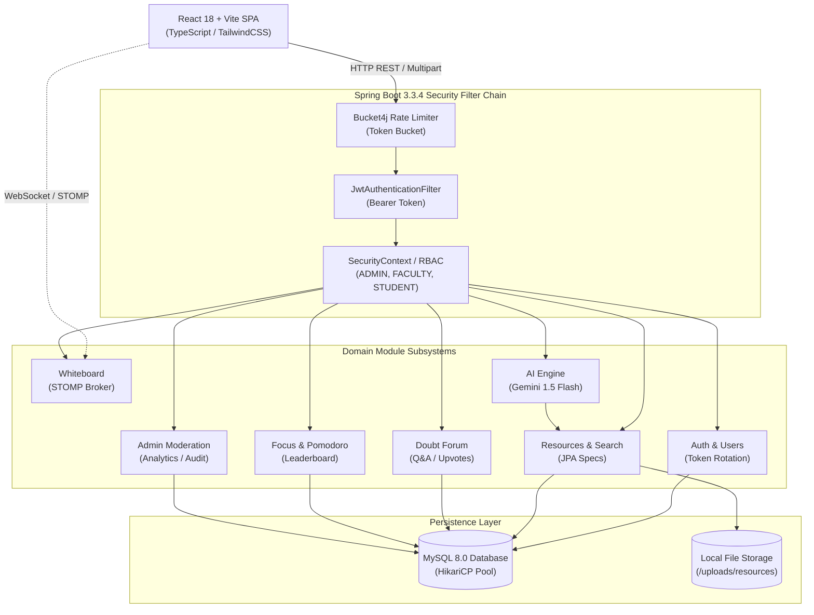

<div align="center">

# 🎓 StudyHub
### Enterprise-Grade AI-Powered Collaborative Academic Platform

[](https://github.com/VenuMadhavi-77/studyhub)
[](https://spring.io/projects/spring-boot)
[](https://www.oracle.com/java/)
[](https://react.dev/)
[](https://www.typescriptlang.org/)
[](https://www.mysql.com/)
[](https://ai.google.dev/)
[](https://www.docker.com/)
[](LICENSE)

<br/>

**A modern, full-stack collaborative academic ecosystem engineered with Spring Boot 3, React 18, Google Gemini AI, and STOMP WebSockets.**

[Key Features](#-core-capabilities) • [Architecture](#-system-architecture) • [Tech Stack](#-technology-stack) • [Quickstart](#-quickstart--installation) • [API Reference](#-api-endpoints-overview) • [Security](#-security--authentication) • [Deployment](#-production-deployment)

</div>

---

## 📌 Executive Summary

Modern universities and college departments frequently struggle with fragmented study materials, unverified exam notes, unorganized discussion forums, and a lack of real-time collaborative study spaces. 

**StudyHub** solves these challenges by uniting academic resource management, real-time peer collaboration, and generative AI into a unified platform:

- **Peer-Reviewed Resource Repository**: Verified PDF lecture notes, reference books, past question papers, and syllabus tracking with Bayesian reliability scoring to eliminate spam and low-quality materials.
- **Generative AI Study Assistant**: Powered by Google Gemini 1.5 Flash to automatically extract key concepts, summarize lecture PDFs, generate exam revision notes, and answer academic doubts 24/7.
- **Interactive Collaborative Whiteboard**: Real-time canvas with multi-user stroke synchronization over STOMP WebSockets and persistent room state snapshots.
- **Student Doubt Forum**: StackOverflow-style Q&A with peer upvoting, accepted answer mechanics, and reputation points.
- **Focus & Gamification**: Integrated Pomodoro focus sessions with department-level weekly leaderboards.
- **Admin Moderation & RBAC**: Complete moderation lifecycle for review, approval, suspension, and external resource curation.

---

## 🚀 Core Capabilities

```
┌────────────────────────────────────────────────────────────────────────────────────────┐
│                                   PLATFORM MODULES                                     │
├─────────────────────┬──────────────────────┬────────────────────┬──────────────────────┤
│ 📚 Resource Hub     │ 🤖 Gemini AI Suite   │ 🎨 Live Whiteboard │ ⚡ Focus & Doubts    │
│ • PDF Upload & Stream│ • Instant Summarizer │ • Multi-User STOMP │ • Pomodoro Timer     │
│ • Bayesian Scoring  │ • PDF Text Extractor │ • Vector Shapes    │ • Dept Leaderboard   │
│ • Self-Review Block │ • Doubt Explanations │ • Snapshot History │ • Solution Upvoting  │
│ • Multi-Tag Filters │ • Fallback Engine    │ • PNG Export       │ • In-App Notifs      │
└─────────────────────┴──────────────────────┴────────────────────┴──────────────────────┘
```

### 1. 📚 Academic Resource Engine
- **Multi-Format Support**: Upload PDF documents, lecture notes, video lectures, and external web resources.
- **Magic-Byte PDF Validation**: Strictly validates file MIME types and PDF magic bytes (`%PDF-`) at the controller level to prevent malicious uploads.
- **Bayesian Weighted Reliability**: Computes weighted trust scores using Bayesian averages:
  $$\text{Reliability} = \frac{v \cdot R + m \cdot C}{v + m}$$
  where $v$ is the review count, $R$ is the average rating, $m$ is the minimum review threshold ($m=5$), and $C$ is the platform baseline ($C=3.5$).
- **Anti-Manipulation Integrity**: Strict database-level and service-level rules prevent students from reviewing or upvoting their own uploaded materials.

### 2. 🤖 Gemini AI Subsystem
- **On-Demand Document Summarization**: Generates executive summaries, key bullet concepts, and high-yield exam revision notes from uploaded PDFs.
- **Automatic Metadata Extraction**: Analyzes document content using Apache PDFBox and recommends subjects, topics, semester levels, and tags.
- **24/7 Doubt Assistant**: Context-aware academic assistant that delivers step-by-step mathematical, algorithmic, and theoretical explanations.
- **Resilient Fallback Mode**: If no Gemini API key is configured, StudyHub automatically activates its built-in structured educational engine, ensuring zero downtime.

### 3. 🎨 Real-Time Collaborative Whiteboard
- **Low-Latency STOMP / WebSocket Synchronization**: Broadcasts pen strokes, geometric shapes (rectangles, circles, lines), and erasers across all active room participants.
- **Canvas Snapshot Persistence**: Room hosts can save high-resolution canvas snapshots directly to MySQL and restore state when rejoining.
- **Room Code Sharing**: Instant 6-character room codes for rapid peer study group sessions.

### 4. ⏱️ Focus Pomodoro & Academic Doubts
- **Pomodoro Timer**: Configurable study intervals with subject tracking.
- **Department Leaderboards**: Ranks top students by weekly completed focus minutes.
- **Discussion Forum**: Threaded Q&A with tag filtering, Markdown support, upvoting, and question author solution acceptance.

---

## 🏗️ System Architecture

StudyHub follows a clean, decoupled **modular monolith** backend paired with a high-performance **React 18 Single-Page Application**.



---

## 🛠️ Technology Stack

| Layer | Component | Specification | Description |
|:---|:---|:---|:---|
| **Backend** | Spring Boot | `v3.3.4` | Enterprise Java application framework |
| | Java SDK | `Java 21 LTS` | Modern virtual threads, records, pattern matching |
| | Spring Security | `v6.3` | Stateless JWT authentication & method-level RBAC |
| | Data Access | `Spring Data JPA / Hibernate 6` | Object-relational mapping with HikariCP pooling |
| | Rate Limiting | `Bucket4j 8.10` | In-memory token bucket brute-force defense |
| | PDF Processing| `Apache PDFBox 3.0` | Server-side PDF parsing and text extraction |
| | Real-Time | `Spring STOMP / SockJS` | Sub-millisecond WebSocket message brokering |
| **Frontend** | React | `v18.3.1` | Concurrent mode single-page application |
| | Language | `TypeScript 5.6` | Strict compile-time type safety |
| | Bundler | `Vite 5.4` | Lightning-fast HMR and optimized production build |
| | Styling | `Tailwind CSS 3.4` | Custom design system with glassmorphism & dark mode |
| | Networking | `Axios 1.7` | Auto-refreshing JWT request & response interceptors |
| | Icons | `Lucide React 0.45` | Modern accessible icon set |
| **Data & Infra**| Database | `MySQL 8.0` | ACID relational database with indexed schemas |
| | Containers | `Docker & Docker Compose` | Multi-stage production container builds |
| | Web Server | `Nginx Alpine` | Reverse proxy and static bundle distribution |

---

## 🔒 Security & Authentication

StudyHub implements enterprise-grade zero-trust security practices:

1. **Dual-Token JWT Authentication**:
   - Short-lived Access Tokens (15 minutes).
   - Long-lived Refresh Tokens (7 days) stored as SHA-256 hashes in MySQL.
2. **Refresh Token Rotation (RTR) & Breach Detection**:
   - Every token refresh generates a new cryptographically secure token pair.
   - If an old/revoked refresh token is replayed, the system detects a breach and **invalidates all active user sessions immediately**.
3. **Bucket4j Rate Limiting**:
   - Token-bucket algorithm prevents brute-force attacks on `/api/v1/auth/**` and AI endpoints.
4. **File Upload Hardening**:
   - Magic-byte validation (`%PDF-`), random UUID file renaming, and strict directory sandboxing prevent path-traversal attacks.
5. **CORS & CSRF**:
   - Stateless JWT design eliminates CSRF vulnerabilities; strict CORS allows only authorized origins.

---

## 🚀 Quickstart & Installation

### Option 1: Docker Compose (Recommended)

Run the full production stack (MySQL + Spring Boot + React/Nginx) with a single command:

```bash
# 1. Clone the repository
git clone https://github.com/VenuMadhavi-77/studyhub.git
cd studyhub

# 2. Configure environment file
cp .env.example .env

# 3. Launch all containers
docker compose up --build -d

# 4. Verify running services
docker compose ps
```

Access the services:
- **Frontend Application**: `http://localhost`
- **Backend API**: `http://localhost:8080/api/v1`
- **Interactive Swagger Docs**: `http://localhost:8080/swagger-ui.html`
- **Health Actuator**: `http://localhost:8080/actuator/health`

---

### Option 2: Local Developer Setup

#### Prerequisites
- **Java JDK 21+** (`java -version`)
- **Apache Maven 3.9+** (`mvn -v`)
- **Node.js 20+ & npm** (`node -v`)
- **MySQL 8.0** running locally on port 3306

#### 1. Backend Setup
```bash
cd backend

# Execute all 41 test suites
mvn test

# Start the Spring Boot development server
mvn spring-boot:run
```
> Backend runs at `http://localhost:8080`

#### 2. Frontend Setup
```bash
cd frontend

# Install dependencies
npm install

# Start Vite hot-reloading dev server
npm run dev
```
> Frontend runs at `http://localhost:3000`

---

## ⚙️ Environment Variables Reference

| Variable | Default Value | Description |
|:---|:---|:---|
| `DB_HOST` | `localhost` | MySQL hostname or cloud connection endpoint |
| `DB_PORT` | `3306` | MySQL port |
| `DB_NAME` | `studyhub_db` | Database schema name |
| `DB_USERNAME` | `root` | Database username |
| `DB_PASSWORD` | *(empty)* | Database password |
| `JWT_SECRET` | *(base64 key)* | 256-bit cryptographically secure secret key |
| `JWT_ACCESS_EXPIRATION_MS` | `900000` | Access token lifespan (15 minutes) |
| `JWT_REFRESH_EXPIRATION_MS`| `604800000` | Refresh token lifespan (7 days) |
| `GEMINI_API_KEY` | *(optional)* | Google AI Studio API key for Gemini 1.5 Flash |
| `STORAGE_LOCAL_PATH` | `./uploads` | Local disk directory for uploaded PDF notes |

---

## 👥 Seeded Demo Accounts

The platform seeds test accounts on initial startup:

| Role | Email Address | Password | Permissions |
|:---|:---|:---|:---|
| **System Admin** | `admin@studyhub.edu` | `AdminStudyHub#2026` | Full platform analytics, moderation queue, user management |
| **Student (CSE)** | `rohan.v@anurag.edu.in` | `Password123#` | Upload resources, participate in whiteboard, ask doubts |
| **Student (ECE)** | `meera.p@anurag.edu.in` | `Password123#` | Peer review resources, answer doubts, focus sessions |

---

## 📡 API Endpoints Overview

| Method | Endpoint | Access | Description |
|:---|:---|:---|:---|
| `POST` | `/api/v1/auth/register` | Public | Student account registration |
| `POST` | `/api/v1/auth/login` | Public | Credentials authentication & JWT issuance |
| `POST` | `/api/v1/auth/refresh` | Public | Atomic refresh token rotation |
| `GET` | `/api/v1/users/me` | Authenticated | Retrieve current user profile |
| `GET` | `/api/v1/taxonomy/departments` | Public | List all engineering departments |
| `GET` | `/api/v1/search/resources` | Public | Dynamic multi-criteria resource search |
| `POST` | `/api/v1/resources` | Authenticated | Multipart upload with PDF file and JSON metadata |
| `GET` | `/api/v1/resources/{id}/download` | Authenticated | Secure file streaming download |
| `POST` | `/api/v1/resources/{id}/reviews` | Authenticated | Submit peer review (Self-review blocked) |
| `POST` | `/api/v1/doubts` | Authenticated | Ask an academic question |
| `POST` | `/api/v1/doubts/{id}/answers` | Authenticated | Post answer to a question |
| `POST` | `/api/v1/whiteboard/sessions` | Authenticated | Create a real-time collaborative canvas room |
| `POST` | `/api/v1/focus/sessions/start` | Student | Begin Pomodoro focus session |
| `GET` | `/api/v1/focus/leaderboard` | Authenticated | Department focus leaderboard |
| `POST` | `/api/v1/ai/doubt-assistant` | Authenticated | AI academic step-by-step doubt assistant |
| `POST` | `/api/v1/ai/summarize/{id}` | Authenticated | Generate AI executive summary & revision notes |
| `GET` | `/api/v1/admin/stats` | Admin | Comprehensive platform metrics |
| `PATCH`| `/api/v1/admin/resources/{id}/moderation`| Admin | Approve or reject uploaded resource |

Full interactive API documentation is accessible via **Swagger UI** at `http://localhost:8080/swagger-ui.html`.

---

## 🧪 Quality Assurance & Test Verification

StudyHub includes automated unit, integration, and end-to-end verification suites:

### 1. Backend JUnit Suite (41 Tests)
```bash
cd backend
mvn test
```
- ✅ **100% Pass Rate (41 / 41 Tests)**
- Covers authentication, token rotation, Bayesian calculations, file uploads, security boundaries, and AI fallback behavior.

### 2. Full System Diagnostic Audit (39 Tests)
```bash
node debug_suite.js
```
- ✅ **39 / 39 End-to-End Verification Checkpoints Passed**
- Validates the complete stack including live database persistence, WebSocket channels, and security gates.

---

## 🚢 Production Deployment

StudyHub includes a one-command automated deployment script [`deploy.sh`](file:///d:/tt-project/tt-project/deploy.sh) for any Ubuntu VPS (AWS EC2, DigitalOcean, Hetzner, Oracle Cloud):

```bash
# SSH into your clean Ubuntu server and run:
git clone https://github.com/VenuMadhavi-77/studyhub.git
cd studyhub
chmod +x deploy.sh
./deploy.sh
```

**What `deploy.sh` handles automatically:**
1. Installs Docker Engine & Docker Compose plugins.
2. Auto-detects public IP and configures production CORS.
3. Generates high-entropy cryptographic secrets for JWT and MySQL.
4. Builds multi-stage optimized Docker images.
5. Runs healthchecks and validates container status.

---

## 📄 License

This project is licensed under the **MIT License** — see the [LICENSE](LICENSE) file for details.

---

<div align="center">

**Developed by [VenuMadhavi-77](https://github.com/VenuMadhavi-77)**

⭐ **Star this repository** if you find it helpful for your studies or engineering projects!

</div>
